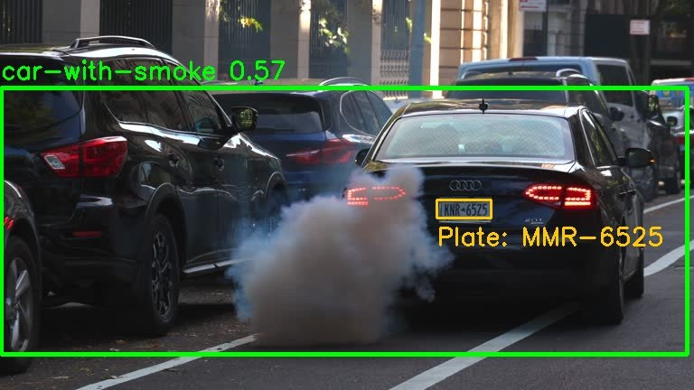
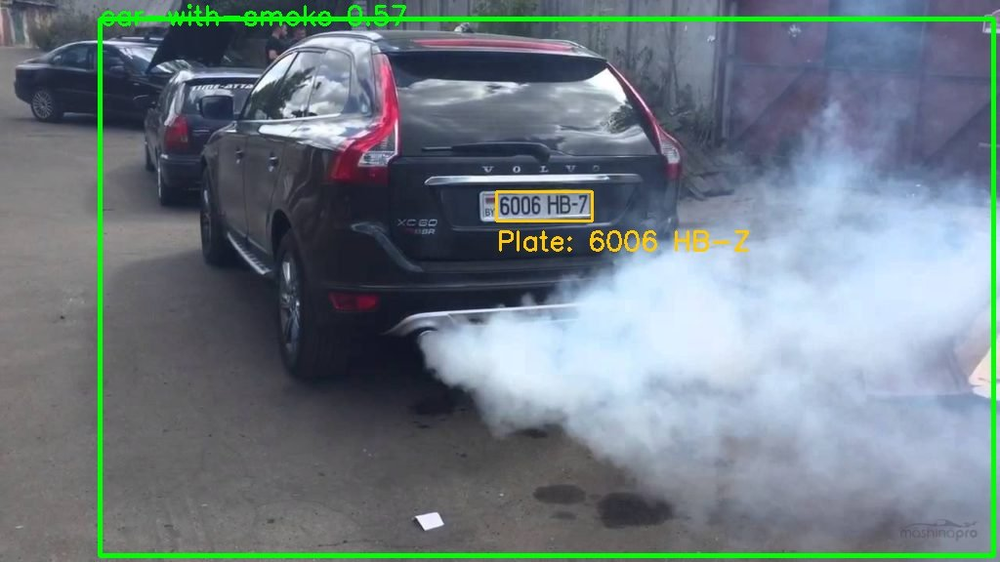

# Cadmium: Car Smoke Detection

Detects cars emitting visible exhaust smoke in video, reads their license plate, and reports the violation to a web app.

## Context

| | |
|---|---|
| **Type** | Hackathon project |
| **Built** | October – November 2024 |
| **Area** | Computer vision |

## Demo

| Smoke detected + plate read | Smoke detected + plate read |
|---|---|
|  |  |

Green box: the Roboflow model's `car-with-smoke` detection with confidence. Orange box: the license plate found by EasyOCR.

## How it works

1. A custom **Roboflow** object-detection model (`car-with-smoke`, v2) runs on every video frame and draws boxes around smoking cars.
2. **EasyOCR** reads the license plate from a captured frame.
3. The result is sent as JSON to the backend (`/api/add-violation`) so violations can be stored and viewed.

## Project structure

| Folder | What's inside |
|---|---|
| `detection/` | Python scripts: `version3.py` (main pipeline), `video.py` / `video_ver.py` (video experiments), `easyocss1.py` (plate OCR), test images |
| `app/` | React + Vite front end for viewing results |

## Tech

Python · OpenCV · Roboflow · Supervision · EasyOCR · React · Vite

## Run it

```bash
cd detection
pip install roboflow supervision opencv-python easyocr numpy requests
cp .env.example .env   # add your Roboflow API key
python version3.py
```

```bash
cd app
npm install
npm run dev
```

## What I learned

Using a custom-trained detection model on video, combining detection with OCR, and connecting a Python pipeline to a web back end.
